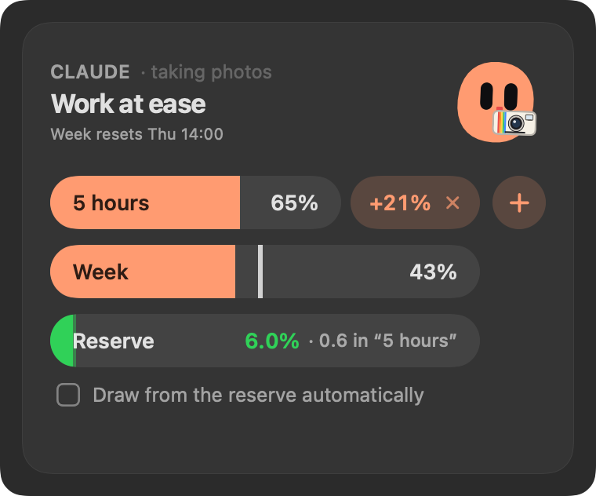
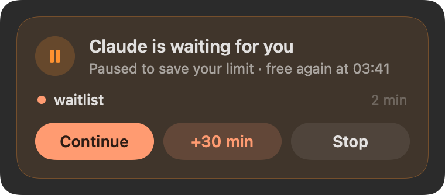

# Slowburn

**English** · [Русский](README.ru.md)

**Burn your AI limits slowly.** Slowburn is a macOS menu bar app that paces your Claude Code and Codex subscription limits so they last all week. It shows how much runway you have right now, saves up what you don't use, and — if you want — pauses your agents before they spend tomorrow's budget.

[Website](https://kdanet.github.io/slowburn/) · MIT license · macOS 14+

<p>
  
  
</p>

## Install

```sh
curl -fsSL https://kdanet.github.io/slowburn/install.sh | sh
```

The script puts the latest release of `Slowburn.app` — signed and notarized by Apple — in `~/Applications`, starts it, and starts it again at login. After that the app updates itself (Sparkle; *Check for Updates…* is in the gear menu). Needs macOS 14+. You can also [download the .zip](https://github.com/kdanet/slowburn/releases/latest) yourself.

To build it on your Mac instead (needs git and Swift 6 — Xcode 16 or later, or its Command Line Tools):

```sh
curl -fsSL https://kdanet.github.io/slowburn/install.sh | sh -s -- --from-source
```

Optional — the soft brake for Claude Code and Codex:

```sh
~/Applications/Slowburn.app/Contents/MacOS/quota integrate claude codex
```

Uninstall (keeps your history unless you remove `~/Library/Application Support/Slowburn` too):

```sh
curl -fsSL https://kdanet.github.io/slowburn/install.sh | sh -s -- --uninstall
```

## What it does

- **Runway, not percentages.** For each provider: a rolling **5-hour** bar (how much of a healthy five-hour stretch you've used, and when it frees up), the **week** against an even plan, and a **reserve** — what lighter hours saved.
- **Borrow from the reserve.** Press **+** to lend the 5-hour limit a bit more for the next five hours, or tick *Draw from the reserve automatically*.
- **Soft brake.** With the hooks installed, Claude Code and Codex pause before a prompt or tool call when you're over the plan. They wait in the menu bar: **Continue**, **+30 min** without the brake, or **Stop** (the agent wraps up and writes down where it stopped). Start a message with `++` to skip the brake once.
- **One big switch.** *Limits on/off* at the top of the panel: off, every hook lets everything through and Slowburn just keeps counting.
- **Companions.** An orange blob for Claude and a violet one for Codex. While an agent works, its blob sits at the laptop doing what the agent does (editing code, running tests, searching the web…), read live from the session log. Between tasks it picks one of forty pastimes.
- **English and Russian**, following the system language (`SLOWBURN_LANG=en|ru` overrides it).

## Privacy and where the numbers come from

Everything runs on your Mac. No account, no analytics, no AI calls.

- **Claude:** the usage endpoint the official CLI uses, with the Claude Code CLI's own access token from the Keychain — read-only, and never refreshed by Slowburn so the CLI is never logged out. When that token has expired, Slowburn runs `claude -p /usage` (a local command, no model call, no cost), which lets the CLI refresh its own token. No separate token is needed.
- **Codex:** `chatgpt.com/backend-api/wham/usage` with the token from `~/.codex/auth.json` (read-only), plus the session logs Codex writes in `~/.codex/sessions`.
- **What agents are doing:** the tail of the session logs in `~/.claude/projects` and `~/.codex/sessions`.
- **Updates:** once a day the app reads `kdanet.github.io/slowburn/appcast.xml`; updates are signed with the project's EdDSA key and notarized.

Slowburn keeps its own files in `~/Library/Application Support/Slowburn/` (`SLOWBURN_HOME` overrides it).

## The soft brake in detail

`quota integrate claude codex` installs a hook on `UserPromptSubmit` and `PreToolUse` in `~/.claude/settings.json` and `~/.codex/hooks.json`. It touches only its own entries and backs up each config first; `quota uninstall-hooks` removes them.

- It holds only when the 5-hour limit or the week's plan is overspent, or when Codex is about to work on paid credits. Otherwise it stays quiet or adds a short warning.
- A held agent waits for a decision in the app. After 55 minutes without one, it is told to stop — never to carry on spending.
- Without a running Slowburn nothing is ever held.
- Try it: start a session with `#brake-demo …` and every tool call in it pauses for an hour.

## Command line

```sh
quota status            # fresh numbers and what the agents are doing
quota allow 30          # take the brake off for 30 minutes
quota replan            # start the plan again from what's left now
quota holds             # agents waiting for a decision
quota release [--deny]  # let them go, or stop them
```

## Building from source

```sh
swift build
.build/debug/Slowburn &            # the menu bar app
SLOWBURN_LANG=ru swift test        # tests check the Russian strings
```

Releases: `scripts/release.sh 1.2.3` builds a universal app, signs it with a Developer ID, notarizes and staples it, publishes a GitHub release and adds it to the appcast (see the script's header for the one-time setup).

Rendering helpers for docs: `--snapshot out`, `--moods out.png`, `--activities out.png [names]`, `--export-ui dir`, `--export-clip out.mp4 popover|blob:<activity>:<claude|codex>`, `--export-icons dir`.

## License

MIT. Slowburn is an independent project, not affiliated with Anthropic or OpenAI. Claude and Codex are trademarks of their owners.
